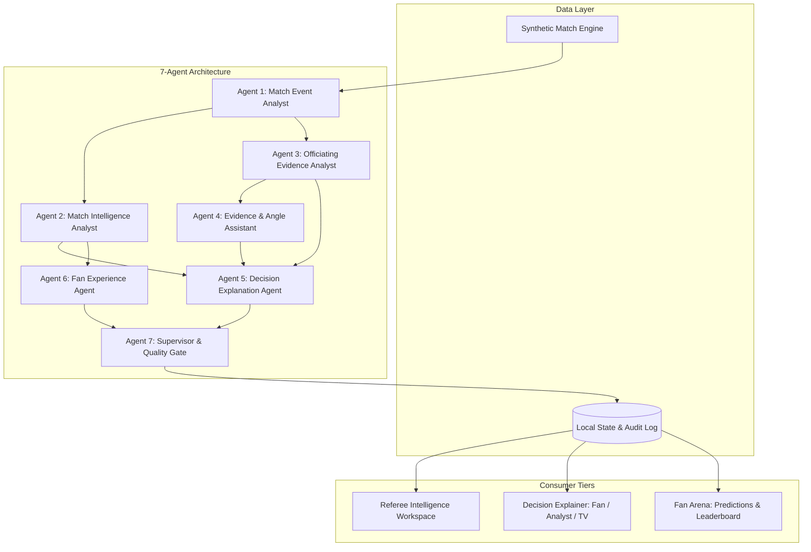

# RefVision AI — Architecture Specification

## 1. System Overview

**RefVision AI** is an explainable AI officiating decision-support platform and interactive match intelligence center designed for the **Microsoft Premier League "Inside the Game: Developer Hackathon 2026"**.

The platform is architected around five pipeline stages:
1. **Ingest:** Chronologically validated synthetic football match event stream with normalized coordinates (0 to 100 meters).
2. **Interpret:** Deterministic statistics (rolling possession, pass completion, tactical momentum curves, xG).
3. **Explain:** IFAB Law grounded explanations synthesized across Fan, Analyst, and Broadcast tiers.
4. **Render:** Responsive bilingual web client (English LTR & Arabic RTL) with interactive 2D pitch tracking, multi-camera angle comparison, and live prediction gamification.
5. **Personalize:** Tailored fan experience with streaks, badges, points, and event-verified outcomes.

---

## 2. Multi-Agent Coordinated System

### Agent Roles & Hand-Off Contracts

1. **Agent 1: Match Event Analyst**
   - Validates schema, coordinate boundaries [0, 100], and chronological order.
   - Rejects or flags anomalous event payloads.

2. **Agent 2: Match Intelligence Analyst**
   - Calculates deterministic rolling possession, pass accuracy, xG, and bounded momentum curve (-100 to +100).
   - Identifies turning points based on goals, cards, and VAR reviews.

3. **Agent 3: Officiating Evidence Analyst**
   - Evaluates flagged incidents against available spatial coordinates and IFAB Law 12/14 context.
   - Formulates tentative assessments while explicitly preserving human referee authority.

4. **Agent 4: Evidence & Angle Assistant**
   - Evaluates camera angles based on collinearity, sightlines, occlusion, and resolution sharpness.
   - Recommends the 18-Yard Left collinear view for boundary challenges.

5. **Agent 5: Decision Explanation Agent**
   - Formulates structured multi-tier explanations (Fan Mode, Analyst Mode, Broadcast Overlay Mode).
   - Formulates mandatory uncertainty disclosures.

6. **Agent 6: Fan Experience Agent**
   - Evaluates live prediction games against subsequent events in the event stream.
   - Awards non-monetary badges and manages user point progression.

7. **Agent 7: Supervisor & Quality Gate**
   - Enforces schema contracts, validates that all claims have verified event references.
   - Verifies the presence of the responsible AI disclaimer.
   - Replaces unverified assertions with certified deterministic fallbacks.

---

## 3. Technology Stack ($0 Zero-Cost Architecture)

- **Backend:** Python 3.13, FastAPI, Uvicorn, Pydantic, Pytest.
- **Frontend:** React 19, TypeScript, Vite, Lucide Icons, CSS Modules.
- **Provider Interface:** `MicrosoftAgentProvider` supporting Microsoft Agent Framework / Azure AI Foundry endpoints, with automatic high-fidelity local deterministic fallback.
- **Persistence:** Replayable seeded state (`MATCH_PL_2026_01`) and in-memory audit log with append-only integrity.
